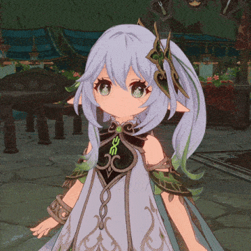

<!-- ───────────────────────── Header ───────────────────────── -->

  

  

  
  
  

 

## 🌱 About Me

Hi, I'm **Jonathan**, a **Fullstack Web & Mobile Developer** who enjoys turning ideas into working software, from the screen in your hand to the server behind it. On the side, I'm also running my own software venture.

- 📱 Building **cross-platform mobile apps** with **Flutter**
- 🧩 Developing **full-stack web apps** with Laravel, React, .NET and Spring Boot
- 🔌 Designing **backends & REST APIs** and integrating third-party services
- 🗄️ Modeling **relational databases** (MySQL, PostgreSQL, SQL Server, Supabase)
- 🌿 Currently exploring **Go, gRPC, Docker & Kafka** for microservices
- 🎮 Outside of code: anime, RPG games and writing

> *"A single seed of curiosity, given time, grows into a forest of understanding."*
> I treat every project the same way - plant a question, nurture it with practice, and let it branch into something useful.

 

## 🍃 Tech Stack

<b>Languages</b>

  

<b>Mobile · Frontend · Backend</b>

  

<b>Database · DevOps · Tools</b>

  

## ✦ Featured Projects

<table>
  <tr>
    <td width="50%" valign="top">
      <h3><a href="https://github.com/JonathanZefanya/satorustream">SatoruStream</a></h3>
      
Anime streaming frontend that consumes the superanime API, with Supabase-powered account features.

      
<code>React</code> <code>TypeScript</code> <code>Vite</code> <code>Tailwind</code> <code>Supabase</code>

      <a href="https://satorustream.vercel.app">🔗 Live</a>
    </td>
    <td width="50%" valign="top">
      <h3><a href="https://github.com/JonathanZefanya/SISEENG">SISEENG</a></h3>
      
A native PHP web application built with the MVC architecture, designed to help churches manage congregational information and activities.

      
<code>PHP</code> <code>MySQL</code>

      <a href="https://gbihouseofprayerciseeng.org">🔗 Live</a>
    </td>
  </tr>
  <tr>
    <td width="50%" valign="top">
      <h3><a href="https://github.com/JonathanZefanya/Aplikasi-Manajemen-Keuangan">Personal Finance Manager</a></h3>
      
Mobile app for managing personal finances, an upgraded version of my earlier budgeting app, built for a mobile programming course.

      
<code>Flutter</code> <code>Dart</code>

    </td>
    <td width="50%" valign="top">
      <h3><a href="https://github.com/JonathanZefanya/Scanner-App">Scanner App</a></h3>
      
Offline document scanner for cards, receipts and letters, no internet connection required.

      
<code>Flutter</code> <code>Dart</code>

    </td>
  </tr>
  <tr>
    <td width="50%" valign="top">
      <h3><a href="https://github.com/JonathanZefanya/Aplikasi-Music-Player">Music Player</a></h3>
      
A modern local music player built with Flutter that allows you to play and manage music stored on your Android device.

      
<code>Dart</code> <code>Flutter</code> <code>Bloc</code> <code>Hive</code>

    </td>
    <td width="50%" valign="top">
      <h3><a href="https://github.com/JonathanZefanya/Shipment-gRPC-Microservise">Shipment gRPC Microservice</a></h3>
      
Learning project exploring microservice architecture with gRPC APIs, a message broker and containerized services.

      
<code>Go</code> <code>gRPC</code> <code>PostgreSQL</code> <code>Kafka</code> <code>Docker</code>

    </td>
  </tr>
</table>

  <a href="https://github.com/JonathanZefanya?tab=repositories"><b>Explore all repositories →</b></a>

## 📖 GitHub Stats

  
  

  

## 🤝 Let's Connect

  Open to collaboration and interesting conversations about mobile, backend or anything in between.

  
  
  
  <!-- TODO: uncomment and fill in once available
  
  
  -->

  Thanks for visiting 🌿 
  

<!-- ───────────────────────── Footer ───────────────────────── -->

  

